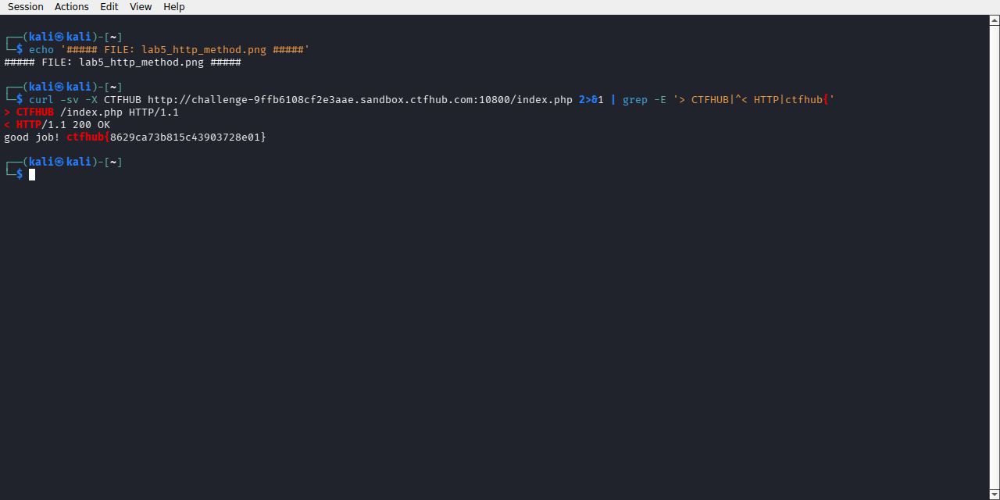

# WP：请求方式

> **CTFHub 路径**：技能树 → Web → Web 前置技能 → HTTP 协议 → 请求方式
> **任务**：按题目要求使用指定的 HTTP 方法访问目标，拿到 flag。
> **提示**：浏览器地址栏默认发送 GET 请求。用 Burp Repeater 修改请求行中的方法，或者用 `curl -X` 复现。
> **截图要求**：优先使用 Burp Repeater，截图中要能看到修改后的请求行（方法 + 路径）和响应中的 flag；如果 Burp 无法启动，可以用 `curl -X` 的方法修改截图代替，并在 WP 中说明原因。只有浏览器普通 GET 访问不算完成。

---

## 题目信息

| 项目 | 内容 |
| --- | --- |
| 环境地址 | http://challenge-9ffb6108cf2e3aae.sandbox.ctfhub.com:10800 |
| Flag | ctfhub{8629ca73b815c43903728e01} |

## 解题过程

打开靶场，页面写着 "HTTP Method is GET，Use CTF**B Method, I will give you flag"，意思是让我用一个叫 CTF**B 的自定义方法来请求。我先用 `curl -X CTFHub http://.../index.php` 试了一次，服务器返回 400 Bad Request，说明方法拼写不对。想到提示里的 `CTF**B` 中间两个星号可能代表两个大写字母，我改用全大写 `curl -X CTFHUB` 再请求 `/index.php`，响应体直接变成了 "good job!" 加上 flag。因为本机 Burp Suite 启动异常，本题改用 `curl -X` 完成，截图里是 Kali 终端中的命令和响应。

## 关键请求/响应

```http
CTFHUB /index.php HTTP/1.1
Host: challenge-9ffb6108cf2e3aae.sandbox.ctfhub.com:10800
User-Agent: curl/8.x

HTTP/1.1 200 OK
Content-Type: text/html; charset=UTF-8

good job! ctfhub{8629ca73b815c43903728e01}
```

用错方法时的响应（`-X CTFHub`）：

```http
HTTP/1.1 400 Bad Request
Server: openresty/1.21.4.2

400 Bad Request
```

## 原理与复盘

请求行由「方法、路径、HTTP 版本」三部分组成，方法位于请求行的最前面，是客户端告诉服务器"想对资源做什么"的部分。方法本质上只是一个任意字符串，HTTP 协议约定了 GET/POST 等常见方法，但服务器完全可以自定义方法——本题服务器就接受一个叫 CTFHUB 的方法并用它做访问控制。这也说明：仅靠请求方法做权限控制是不可靠的，因为客户端可以任意改写请求行。

---

## 截图



> 可以在这份 WP 中另加过程截图；检查时只看指定图片，额外图片不检查。
