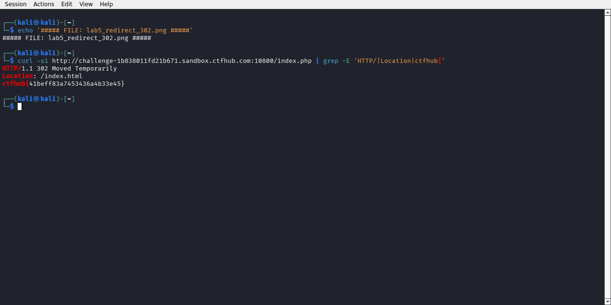

# WP：302 跳转

> **CTFHub 路径**：技能树 → Web → Web 前置技能 → HTTP 协议 → 302 跳转
> **任务**：观察 302 重定向，按题目提示找到 flag。
> **提示**：浏览器通常会自动跟随 302，所以你可能只看到最终页面。打开 DevTools 的 Network 面板（勾选 Preserve log）或 Burp，查看原始响应中的 `302` 状态码和 `Location` 响应头。
> **截图要求**：能看到 302 状态码和/或 `Location` 响应头，以及最终的 flag。只截最终页面、没有 302 证据的截图不合格。

---

## 题目信息

| 项目 | 内容 |
| --- | --- |
| 环境地址 | http://challenge-1b838011fd21b671.sandbox.ctfhub.com:10800 |
| Flag | ctfhub{41beff83a7453436a4b33e45} |

## 解题过程

打开靶场，页面标题是 "No Flag here!"，但中间有个 "Give me Flag" 的链接指向 `/index.php`。在浏览器里点它只会被弹回原页面——因为浏览器自动跟随了重定向，中间过程根本看不到。我改用 `curl -si http://.../index.php` 直接看原始响应：状态行是 `302 Moved Temporarily`，响应头里 `Location: /index.html`，而这个 302 响应的响应体里赫然就是 flag。浏览器跟随跳转时会把 302 响应体直接丢弃，所以只有用 curl 这类能看到原始报文的工具才能拿到它。flag 提交后平台提示正确。

## 关键请求/响应

```http
GET /index.php HTTP/1.1
Host: challenge-1b838011fd21b671.sandbox.ctfhub.com:10800
User-Agent: curl/8.x

HTTP/1.1 302 Moved Temporarily
Server: openresty/1.21.4.2
Location: /index.html
X-Powered-By: PHP/5.6.40

ctfhub{41beff83a7453436a4b33e45}
```

## 原理与复盘

302 和 200 在浏览器里的表现完全不同：200 直接渲染响应体，302 则不会显示内容，而是立刻向 `Location` 指向的地址发起一个新请求，中间响应对用户是不可见的。本题正是利用了这一点——flag 放在被跳转"跳过"的那个响应体里。这让我意识到安全分析必须回到原始报文，浏览器展示的不等于服务器真正发来的内容，`curl -i` 或 Burp 才能看到全貌。

---

## 截图



> 可以在这份 WP 中另加过程截图；检查时只看指定图片，额外图片不检查。
